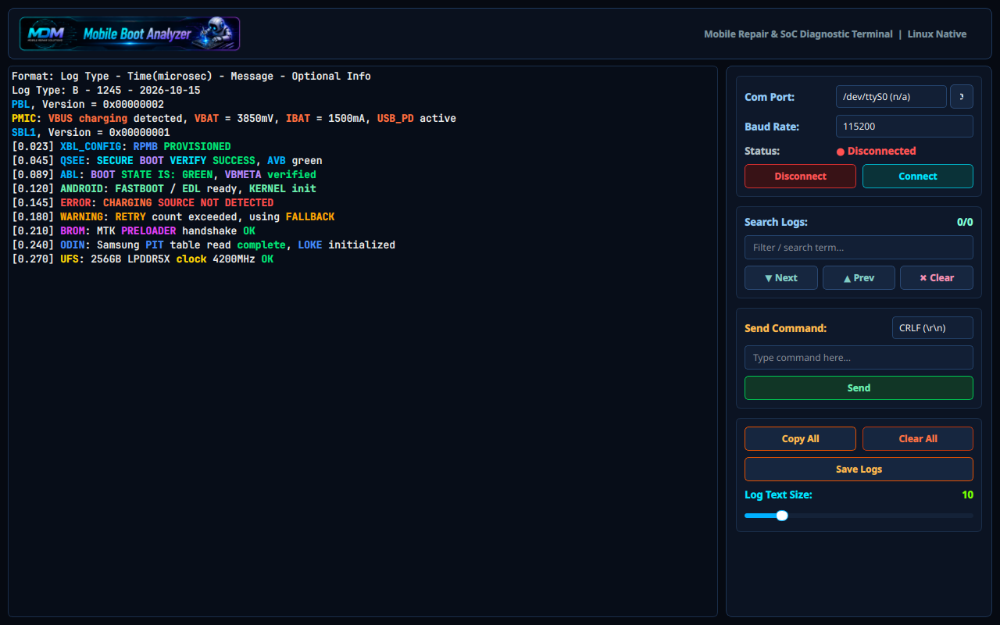

# MDM UART Monitor (Linux Standalone Edition)

A high-performance standalone Linux diagnostic terminal and UART bootloader monitor built with **Python 3 & Qt6 (PySide6)**, reverse-engineered and ported from the original Windows Mobile Doctor tool.



---

## Features

- **Direct Standalone Execution**: Launches directly into the diagnostic monitor with zero cloud logins, registration keys, or HWID dependencies.
- **Linux Serial Port Management**: Automatic discovery of `/dev/ttyUSB*`, `/dev/ttyACM*`, and `/dev/ttyS*` devices with hardware descriptions.
- **Baud Rates**: Full support for standard and high-speed rates: `9600`, `19200`, `38400`, `57600`, `115200` (default), `230400`, `460800`, `921600` bps (8N1).
- **SoC & Bootloader Syntax Highlighting**: Real-time regex highlighting for:
  - **Qualcomm**: `PBL`, `SBL`, `XBL`, `QSEE`, `QHEE`, `RPM`, `SMEM`, `AOP`, `SPMI`, `TZ`, `AVB`, `PMIC`, etc.
  - **MediaTek (MTK)**: `BROM`, `PRELOADER`, `LK`, `LK2`, `DA`, `PL`, `RPMB`, `SLA`, `DAA`, `META`.
  - **Samsung**: `ODIN`, `LOKE`, `PIT`, `PARAM`, `EFS`, `CSC`, `BL`, `CP`, `AP`.
  - **Android**: `FASTBOOT`, `EDL`, `ADB`, `INIT`, `DM-VERITY`, `SELINUX`, `RECOVERY`.
  - **Hardware / PMIC**: `VBUS`, `VBAT`, `IBAT`, `USB_PD`, `QC`, `UFS`, `EMMC`, `LPDDR`, `I2C`, `SPI`, `GPIO`.
  - **Status States**: Red (Errors / Panics), Orange (Warnings / Fallbacks), LimeGreen (Success / Ready / Green Boot).
- **Rx Baud Rate Mismatch Warning**: Real-time detection of high unprintable / replacement character rates (`IsGarbageData` algorithm) alerting to incorrect baud rates.
- **Log Search & Navigation**: Live filtering, occurrence count (`X/Total`), Next (`Enter`), Previous (`Shift+Enter`), and Clear.
- **Command Sender**: Interactive terminal sender with configurable line endings (`CRLF`, `LF`, `CR`, `Raw`).
- **Log Management**: One-click **Copy All**, **Clear All**, and **Save Logs** (`UART_Log_YYYYMMDD_HHMMSS.txt`).
- **Dynamic Font Scaling**: Slider to adjust monospace log font size on the fly (8pt to 22pt).
- **Wayland & High-DPI Native**: Hardware-accelerated rendering on modern Linux (Fedora Asahi Remix, Ubuntu, Arch, etc.).

---

## Quick Start

### 1. Run Directly
```bash
cd /home/shaanair/Projects/MobileDoctor
./run.sh
```
or:
```bash
python3 mdm_monitor/main.py
```

### 2. Linux Serial Permissions
To access USB serial adapters (`/dev/ttyUSB0`, `/dev/ttyACM0`) without `sudo`, ensure your user belongs to the `dialout` or `uucp` group:
```bash
sudo usermod -aG dialout $USER
```
*(Log out and log back in for changes to take effect).*

### 3. Optional: Install to Desktop App Menu
To add MDM UART Monitor to your Linux application menu and dock:
```bash
cp mdm-uart-monitor.desktop ~/.local/share/applications/
update-desktop-database ~/.local/share/applications/
```

---

## Project Structure
- [`mdm_monitor/`](file:///home/shaanair/Projects/MobileDoctor/mdm_monitor):
  - [`main.py`](file:///home/shaanair/Projects/MobileDoctor/mdm_monitor/main.py): Application entry point
  - [`ui_main.py`](file:///home/shaanair/Projects/MobileDoctor/mdm_monitor/ui_main.py): Qt6 graphical user interface and event handlers
  - [`highlighter.py`](file:///home/shaanair/Projects/MobileDoctor/mdm_monitor/highlighter.py): QSyntaxHighlighter with complete SoC keyword patterns
  - [`serial_worker.py`](file:///home/shaanair/Projects/MobileDoctor/mdm_monitor/serial_worker.py): Asynchronous serial communication worker with garbage detection
- [`assets/`](file:///home/shaanair/Projects/MobileDoctor/assets): Original extracted UI assets (Banner, Logos, Icons)
- [`run.sh`](file:///home/shaanair/Projects/MobileDoctor/run.sh): Executable launch script
