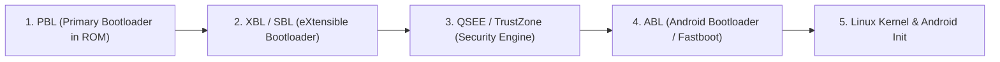

# MDM UART Monitor: Detailed User Guide & Technical Manual

Welcome to the comprehensive user guide for **MDM UART Monitor (Linux Diagnostic Edition)**. This manual provides a complete walkthrough of every feature, hardware connection best practices, mobile SoC bootloader diagnostics, and troubleshooting workflows.

---

## Table of Contents
1. [Overview & Architecture](#1-overview--architecture)
2. [Prerequisites & System Setup](#2-prerequisites--system-setup)
   - [Serial Hardware Permissions](#serial-hardware-permissions)
   - [Application Installation & Desktop Shortcut](#application-installation--desktop-shortcut)
3. [Hardware Connection & Wiring Guide](#3-hardware-connection--wiring-guide)
   - [Voltage Levels & 1.8V Warning](#voltage-levels--18v-warning)
   - [Pinout Connection](#pinout-connection)
   - [Common Phone Hardware Interfaces](#common-phone-hardware-interfaces)
4. [Feature-by-Feature Reference](#4-feature-by-feature-reference)
   - [1. Serial Port Connection Panel](#1-serial-port-connection-panel)
   - [2. Diagnostic Terminal & Smart Auto-Scroll](#2-diagnostic-terminal--smart-auto-scroll)
   - [3. SoC & Bootloader Highlighting Engine](#3-soc--bootloader-highlighting-engine)
   - [4. Rx Garbage & Baud Mismatch Detection](#4-rx-garbage--baud-mismatch-detection)
   - [5. Search & Log Navigation](#5-search--log-navigation)
   - [6. Interactive Command Sender](#6-interactive-command-sender)
   - [7. Log Management (Copy, Clear, Save)](#7-log-management-copy-clear-save)
   - [8. Dynamic Font Size Adjustment](#8-dynamic-font-size-adjustment)
5. [SoC Diagnostic Log Interpretation](#5-soc-diagnostic-log-interpretation)
   - [Qualcomm Boot Stages (PBL → XBL → ABL → Linux Kernel)](#qualcomm-boot-stages)
   - [MediaTek Boot Stages (BROM → Preloader → LK)](#mediatek-boot-stages)
   - [Samsung Exynos/Qualcomm Boot](#samsung-boot)
6. [Troubleshooting & FAQs](#6-troubleshooting--faqs)

---

## 1. Overview & Architecture

**MDM UART Monitor** is a specialized real-time serial terminal and diagnostic analyzer tailored for mobile phone repair technicians, reverse engineers, and embedded hardware developers.

Unlike generic terminal emulators (such as `minicom` or `picocom`), MDM UART Monitor incorporates:
- **Phone SoC Domain Awareness**: Built-in regex highlighting engines tailored for Qualcomm, MediaTek, Samsung, and Android bootloaders.
- **Baud Mismatch Intelligence**: Automatic heuristic detection of baud mismatch errors (`IsGarbageData`).
- **High-Burst Concurrency**: Asynchronous worker thread architecture decoupling serial I/O from Qt6 GUI rendering to prevent UI freezing during 921,600 baud boot log bursts.
- **Direct Standalone Operation**: Zero cloud dependencies, zero licensing servers, and zero telemetry.

---

## 2. Prerequisites & System Setup

### Serial Hardware Permissions
On Linux, USB-to-UART bridge chips (such as FTDI FT232R, Silicon Labs CP2102/CP2104, WCH CH340, and Prolific PL2303) appear under `/dev/ttyUSB*` or `/dev/ttyACM*`. By default, access to these devices is restricted to the `dialout` or `uucp` group.

To grant your Linux user permission without needing `sudo`:
```bash
sudo usermod -aG dialout $USER
```
*(On Arch Linux / Manjaro, use `uucp` instead of `dialout`)*:
```bash
sudo usermod -aG uucp $USER
```
> [!IMPORTANT]
> You must **log out and log back in** (or restart your desktop session) for group membership changes to take effect.

### Application Installation & Desktop Shortcut
To launch the application from the project folder:
```bash
cd /home/shaanair/Projects/MobileDoctor
./run.sh
```

To install the desktop launcher so the app appears in your GNOME / KDE / Wayland application menu and dock:
```bash
cp /home/shaanair/Projects/MobileDoctor/mdm-uart-monitor.desktop ~/.local/share/applications/
update-desktop-database ~/.local/share/applications/
```

---

## 3. Hardware Connection & Wiring Guide

### Voltage Levels & 1.8V Warning

> [!CAUTION]
> **CRITICAL VOLTAGE LEVEL WARNING**: Almost all modern smartphones (Qualcomm Snapdragon, MediaTek Dimensity/Helio, Samsung Exynos, Google Tensor) operate their debug UART lines at **1.8V logic level**.
> **NEVER connect standard 3.3V or 5V USB-TTL adapters directly to smartphone test points.** Doing so can permanently destroy the phone's Power Management IC (PMIC) or the CPU's SoC GPIO pads.
> **Always use a 1.8V-compatible USB-UART adapter** (such as a CP2102N with VIO set to 1.8V, FTDI FT232H configured for 1.8V, or a bidirectional TXS0108E / TXB0104 level shifter).

### Pinout Connection

| USB-to-UART Adapter Pin | Smartphone Test Point (TP) | Notes |
| :--- | :--- | :--- |
| **GND** | **Phone GND / Shielding** | **Mandatory**: Common ground reference is essential for clean signal. |
| **RXD** | **Phone TXD (UART_TX)** | Phone transmits boot logs to adapter receive pin. |
| **TXD** | **Phone RXD (UART_RX)** | Adapter transmits commands to phone console (optional if read-only). |
| **VCC** | *DO NOT CONNECT* | Leave disconnected unless using it to power a level-shifter VCCA. |

### Common Phone Hardware Interfaces
1. **PCB Test Points (TP)**: Located under motherboard EM shields. Labeled as `UART_TX`, `UART_RX`, or small round gold pads near the CPU/PMIC.
2. **Headphone Jack / Type-C UART**:
   - Samsung Type-C cables: UART mode triggered by specific pull-down resistor values between CC/ID pins and GND (e.g., 523kΩ or 619kΩ).
   - EDL Cables: 9008 mode switch cables grounding D+ / D-.

---

## 4. Feature-by-Feature Reference

### 1. Serial Port Connection Panel
Located at the top right of the application window:

- **Com Port Dropdown**: Lists all detected serial ports on your system (`/dev/ttyUSB0`, `/dev/ttyACM0`, etc.) along with USB device vendor labels (e.g. `FTDI FT232R USB UART`).
- **Refresh Button (`⟳`)**: Scans `/dev` and PySerial enumerator for newly attached USB adapters without restarting the application.
- **Baud Rate Dropdown**:
  - `115200` *(Default)*: Standard for almost all Qualcomm, MTK, and Android bootloaders.
  - `921600` / `460800`: High-speed UART used during fast flash/RAM dumps.
  - `57600` / `38400` / `19200` / `9600`: Used on older GPS, baseband modems, or microcontrollers.
- **Connect Button**: Opens the serial port with standard parameters: **8 Data Bits, No Parity, 1 Stop Bit (8N1)**.
- **Disconnect Button**: Closes the port cleanly and stops the background reader.
- **Status Indicator**:
  - `● Connected` *(Lime Green)*: Port active and streaming.
  - `● Disconnected` *(Red)*: Port closed.
  - `● Connection Failed` *(Orange)*: Displays descriptive error (e.g. Permission Denied).

### 2. Diagnostic Terminal & Smart Auto-Scroll
- **Monospace Display**: High-performance text buffer using native monospace typography (`Consolas`, `JetBrains Mono`, or `monospace`).
- **Smart Auto-Scroll**:
  - When the scrollbar is at the bottom, incoming log lines auto-scroll down smoothly.
  - If you scroll up to inspect previous error logs or Qualcomm PBL tokens, **auto-scroll pauses automatically** so the text does not jump while reading.
  - Scrolling back to the bottom instantly re-engages live tracking.
- **100,000-Line Safe Buffer**: Automatically trims historical lines beyond 100k blocks to prevent system memory exhaustion during multi-day stress testing.

### 3. SoC & Bootloader Highlighting Engine
The monitor implements the exact regular-expression keyword dictionaries from the original Mobile Doctor engine, color-coding log lines in real time:

| Category | Color | Sample Keywords | Diagnostic Purpose |
| :--- | :--- | :--- | :--- |
| **Error / Panic** | **Red** (`#FF4D4D`) | `PANIC`, `ERROR`, `FAILED`, `CRC ERROR`, `CORRUPTED`, `OVERFLOW`, `TIMEOUT`, `CHARGING SOURCE NOT DETECTED` | Highlights fatal hardware exceptions, watchdog timeouts, and read errors. |
| **Warning** | **Orange** (`#FFA600`) | `WARNING`, `WARN`, `RETRY`, `FALLBACK`, `UNSUPPORTED`, `DISABLED`, `MISSING` | Highlights degraded modes, fallback firmware paths, and retry attempts. |
| **Success** | **Lime Green** (`#00E676`) | `BOOT COMPLETE`, `SUCCESS`, `DEVICE READY`, `RPMB PROVISIONED`, `BOOT STATE IS: GREEN`, `OK` | Indicates healthy stage handoffs, verified signatures, and ready peripherals. |
| **Security** | **Cyan** (`#00E5FF`) | `SECURE BOOT`, `SECBOOT`, `AVB`, `VBMETA`, `RPMB`, `FRP`, `LOCKED`, `UNLOCKED` | Identifies security hardware, Android Verified Boot state, and cryptographic checks. |
| **Qualcomm SoC** | **Deep Sky Blue** (`#00B0FF`) | `PBL`, `SBL1`, `XBL`, `XBL_CONFIG`, `ABL`, `QSEE`, `QHEE`, `RPMH`, `AOP`, `SPMI`, `QCOM` | Traces Qualcomm Snapdragon boot stages from Primary Bootloader through Android Bootloader. |
| **MediaTek (MTK)** | **Magenta** (`#E040FB`) | `BROM`, `PRELOADER`, `LK`, `LK2`, `DA`, `PL`, `RPMB`, `SLA`, `DAA`, `BOOTROM` | Traces MediaTek Dimensity/Helio Boot ROM handoffs and Little Kernel initialization. |
| **Samsung** | **Dodger Blue** (`#448AFF`) | `ODIN`, `LOKE`, `PIT`, `PARAM`, `EFS`, `CSC`, `BL`, `CP`, `AP` | Identifies Samsung partition tables (PIT), Odin download mode, and baseband modem parameters. |
| **Android System** | **Spring Green** (`#69F0AE`) | `ANDROID`, `KERNEL`, `SYSTEM`, `RECOVERY`, `FASTBOOT`, `EDL`, `DM-VERITY`, `SELINUX`, `ROOT` | Highlights OS-level transitions, Fastboot mode, EDL recovery, and SELinux enforcement. |
| **Hardware Chips** | **Gold** (`#FFD700`) | `PMIC`, `DDR`, `LPDDR`, `UFS`, `EMMC`, `NAND`, `I2C`, `SPI`, `CLOCK`, `PLL`, `THERMAL`, `MODEM` | Pinpoints physical memory (UFS/eMMC/DDR), Power Management ICs, and bus controllers. |
| **Charging Power** | **Coral** (`#FF6E40`) | `CHARGER`, `CHARGING`, `VBUS`, `VBAT`, `IBAT`, `TYPEC`, `USB_PD`, `QC`, `POWER DELIVERY` | Diagnoses battery detection, VBUS presence, charging current, and USB-PD negotiation. |
| **Partitions** | **Violet** (`#B388FF`) | `BOOT`, `SUPER`, `VENDOR`, `DTBO`, `USERDATA`, `METADATA`, `PERSIST`, `MODEM`, `EFS` | Tracks flash partition mounting and storage filesystem checks. |

### 4. Rx Garbage & Baud Mismatch Detection
When connecting to an unknown serial line or using the wrong baud rate (e.g. device is at 115,200 baud but monitor is set to 9600), the incoming data will consist of nonsensical binary control bytes and `?` replacement characters.

- **Automated Algorithm**: The monitor continuously evaluates incoming byte batches. If 2 or more `?` characters and non-printable control bytes are observed in a burst, the **Rx Warning Banner** automatically appears:
  ```
  ⚠️ Rx Warning: High rate of non-printable / garbage bytes detected! Please check if the selected Baud Rate matches your device UART.
  ```
- **Auto-Clearing**: Once valid ASCII/UTF-8 data flows cleanly for 3 seconds, the warning banner automatically hides.

### 5. Search & Log Navigation
- **Search Input Field**: Type any keyword (e.g., `PANIC`, `XBL`, `VBAT`).
- **Live Match Counter**: Shows current position and total occurrences (e.g., `1/14`).
- **Navigation Controls**:
  - **▼ Next**: Advances to next occurrence (Shortcut: `Enter`).
  - **▲ Prev**: Reverses to previous occurrence (Shortcut: `Shift+Enter`).
  - **✖ Clear**: Clears search text and cursor highlighting.

### 6. Interactive Command Sender
Allows sending serial commands to interactive bootloaders (e.g., U-Boot CLI, Little Kernel shell, fastboot serial interface, or root debug consoles):
- **Command Box**: Type single or multi-line commands.
- **Line Ending Selector**:
  - `CRLF (\r\n)` *(Default)*: Standard for Windows/DOS and most embedded serial bootloaders.
  - `LF (\n)`: Standard for Linux/UNIX bash consoles.
  - `CR (\r)`: Standard for classic Mac / U-Boot prompts.
  - `Raw (None)`: Sends exact characters typed without adding terminator bytes.
- **Send Button / Keypress**: Pressing `Enter` in the command input box immediately sends the text over UART.

### 7. Log Management (Copy, Clear, Save)
- **Copy All**: Copies the entire log buffer directly into the Linux system clipboard (compatible with Wayland and X11 clipboard managers).
- **Clear All**: Instantly empties the terminal window and resets search counters.
- **Save Logs**: Opens the Linux file dialog. Automatically suggests a clean timestamped filename:
  ```
  UART_Log_YYYYMMDD_HHMMSS.txt
  ```

### 8. Dynamic Font Size Adjustment
- **Slider Control**: Scale the terminal font size between `8pt` and `22pt` in real time.
- Ideal for high-resolution displays (4K, Retina, 1080p laptop panels) or benchtop workshop setups.

---

## 5. SoC Diagnostic Log Interpretation

### Qualcomm Boot Stages
When a healthy Qualcomm smartphone boots, you will observe the following sequence:

1. **PBL**: Primary Bootloader in Read-Only Memory. Initializes PMIC, clock generators, and checks security fuses. If storage is dead or unformatted, phone falls back into **EDL (Emergency Download 9008 Mode)**.
2. **XBL / XBL_CONFIG**: Checks DDR/LPDDR configuration and provisions RPMB on UFS storage.
3. **QSEE / QHEE**: QualComm Snapdragon Execution Environment. Authenticates cryptographic signatures against OEM fuses (`AVB`, `VBMETA`).
4. **ABL**: Android Bootloader. Manages user display, battery animation, Fastboot mode, and launches the boot image.
5. **Kernel**: Linux kernel decompression and Android `init` mounting `/system`, `/vendor`, and `/super`.

### MediaTek Boot Stages
1. **BROM**: Boot ROM embedded on chip. Negotiates with download tools or branches to Preloader.
2. **Preloader**: Initializes DRAM parameters and verifies storage partitions.
3. **Little Kernel (LK/LK2)**: Bootloader interface, displays OEM logo, checks key combinations (Recovery, Fastboot), and transfers execution to Linux.

---

## 6. Troubleshooting & FAQs

### Q1: "Permission denied accessing /dev/ttyUSB0"
**Cause**: Your Linux user does not have permission to read/write serial hardware.  
**Fix**: Add yourself to the `dialout` group and restart your session:
```bash
sudo usermod -aG dialout $USER
```

### Q2: Port connects, but nothing appears in the log window
1. **Check TX/RX wiring**: Ensure adapter **RX** is connected to phone **TX**. If in doubt, swap TX and RX.
2. **Check Ground (GND)**: A common ground wire between the adapter and the phone chassis/shielding is mandatory.
3. **Phone Power**: Boot logs are emitted during the initial 5–15 seconds after pressing Power. Connect the monitor **before** powering on the device.
4. **Baud Rate**: Verify if the phone uses 115,200 bps or another rate.

### Q3: Logs show garbage characters like `????`
**Cause**: Baud rate mismatch.  
**Fix**: The yellow **Rx Warning Banner** will appear. Disconnect and switch the baud rate dropdown (e.g. from 115,200 to 921,600 or 57,600) and reconnect.

### Q4: Phone shuts down immediately when connecting UART wires
**Cause**: Dangerous voltage mismatch. If your adapter outputs 3.3V or 5V into a 1.8V SoC line, protection diodes trigger or PMIC enters fault shutdown.  
**Fix**: Immediately disconnect! Use a proper **1.8V level shifter**.

---

*Authored for the Mobile Repair & Linux Hardware Engineering Community.*
